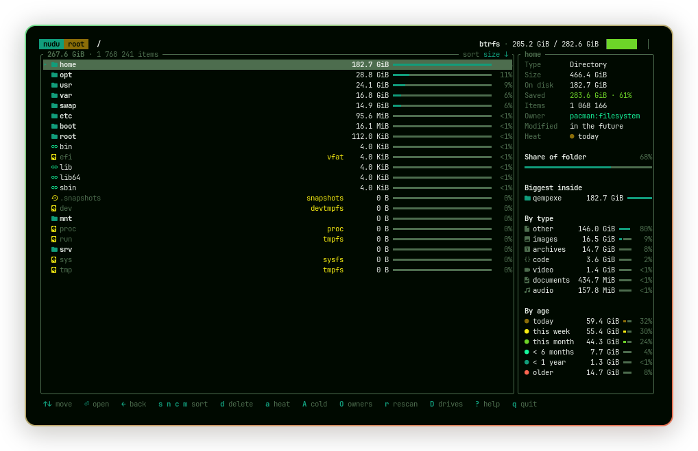

# nudu

**new du** · *Never Underestimate Disk Usage*

[](https://github.com/qempexe/nudu/actions/workflows/ci.yml)
[](https://github.com/qempexe/nudu/releases)

A fast terminal disk usage analyzer. Scan a folder, browse it, and see what is eating your disk.



## Features

- **Fast parallel scan** on all CPU cores, with a live progress screen (`Esc` cancels)
- **Understands filesystems**: btrfs subvolumes (like `/home`) and ZFS datasets of one pool count as one filesystem,
  other disks are labeled and skipped (`--cross-fs` includes them), `/proc`, `/sys` and btrfs snapshots are never double counted
- **Mounted drives**: a drives list (`D`) with type and usage of every disk, see how full a drive is before
  scanning it, `Enter` scans it on demand, and when you plug something in nudu tells you where it was
  mounted (`g` jumps straight there)
- **Real sizes**: both apparent size and space actually used on disk, hard links counted once,
  sparse files stay sparse, and on network/FUSE drives that don't report disk use (sshfs, rclone) sizes are estimated and marked `≈`
- **Sorting** by size, name, item count or last change, in either direction
- **Filter** (`/`): type part of a name and the list narrows as you type, with the total size of what matches
- **Safe delete**: always asks first, removes what it can, never enters mounted drives, totals update instantly
- **Details pane** with sizes, space saved by compression or sparse files, share of the folder,
  the biggest items inside a folder and a breakdown by type (video, images, code, archives...)
- **Age heat**: `a` colors every bar by when it last changed (today → years ago) and shows its age,
  `A` switches to a cold view that only shows data older than a year (or six months), sized by how much old data is inside
- **Owners**: every file is tagged with who it belongs to: a package (`pacman:firefox`, `dpkg:…`), a git repo,
  a Flatpak app, Steam or a single game, Docker, or an app's cache, config or data folder.
  System files no package claims show up as `unowned`. `O` ranks who uses the most space,
  and deleting a package's files reminds you to use the package manager instead
- **Filesystem header** showing the filesystem type and how full it is
- **Follows your terminal theme**: all colors come from your terminal's palette

### Planned

- **btrfs-aware sizes**: compression savings and space shared with snapshots

## Install

### Prebuilt binary

Static binaries for x86_64 and ARM64 are attached to every
[release](https://github.com/qempexe/nudu/releases). They run on any Linux distribution.

```sh
curl -LO https://github.com/qempexe/nudu/releases/latest/download/nudu-v0.1.0-x86_64-unknown-linux-musl.tar.gz
tar xzf nudu-v0.1.0-x86_64-unknown-linux-musl.tar.gz
sudo install -m 755 nudu-v0.1.0-x86_64-unknown-linux-musl/nudu /usr/local/bin/nudu
```

### From source

Requires Rust 1.88 or newer.

```sh
git clone https://github.com/qempexe/nudu.git
cd nudu
./install.sh
```

This builds nudu and installs it to `/usr/local/bin`, so both `nudu` and `sudo nudu` work.
Remove it again with `./install.sh --uninstall`.

Prefer a user-only install? `cargo install --path .` puts it in `~/.cargo/bin` instead
(sudo won't find it there, but nudu can still restart itself as root, see below).

### Folders you can't read

Some folders belong to root or other users. nudu marks them with `!` and keeps going.
Press `S` to rescan with sudo: nudu restarts itself as root with the same options.
A red **root** badge in the header shows when it runs with root rights.

## Usage

```sh
nudu              # current folder
nudu ~            # your home folder
nudu / --cross-fs # everything, including other mounted filesystems
nudu --no-icons   # plain characters if you don't use a Nerd Font
nudu -t 4         # limit scanning to 4 threads
nudu -r           # read-only: deleting is turned off
```

| Key | Action |
|---|---|
| `↑` `↓` / `k` `j` | Move |
| `PgUp` `PgDn` / `Home` `End` | Jump |
| `Enter` / `→` / `l` | Open folder |
| `←` / `h` / `<` | Back |
| `/` | Filter the open folder by name, `Enter` keeps the filter, `Esc` clears it |
| `Enter` on a drive | Scan that mounted drive and open it |
| `r` | Rescan the open folder (new files, new mounts) |
| `D` | List all mounted drives, `Enter` opens one |
| `g` | Open the drive that was just mounted |
| `a` | Heat: color bars by age, show age instead of share |
| `A` | Cold view: only data older than 1 year, again for 6 months, again to turn off |
| `o` | Show owner tags in the list |
| `O` | Owners ranking: who uses the most space in this folder |
| `s` `n` `c` `m` | Sort by size, name, item count, last modified (again to reverse) |
| `d` / `Del` | Delete the selected entry (asks first, `y` to confirm) |
| `S` | Rescan with sudo (when some folders were unreadable) |
| `?` | Help |
| `q` / `Esc` | Quit |

Icons use [Nerd Fonts](https://www.nerdfonts.com/). Use `--no-icons` if they show up as boxes.

## Changelog

See [CHANGELOG.md](CHANGELOG.md).

## License

[MIT](LICENSE)
